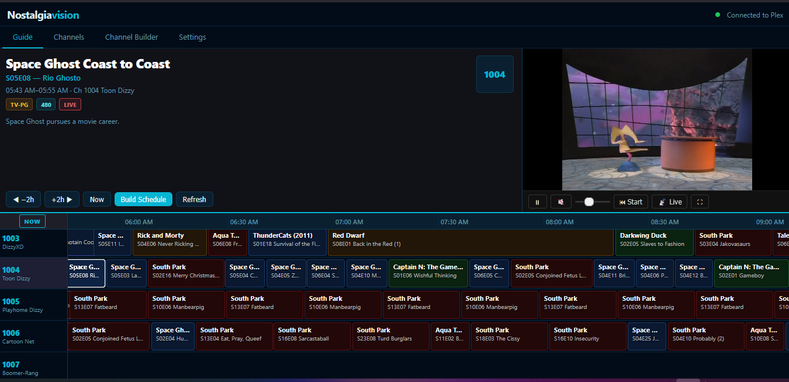

# NostalgiaVision

A self-hosted, retro TV experience powered by your Plex media server. NostalgiaVision turns your personal media library into a live TV broadcast — complete with a scrollable program guide, channel surfing, live preview, and automatic scheduling.

Built with Python, runs on Windows and Linux, and opens in any modern web browser — no app install required.



## What it does

NostalgiaVision generates a rolling multi-day TV schedule from your Plex library and presents it as a classic electronic program guide (EPG). Content plays back through your browser as a live stream, advancing automatically from one program to the next — no clicking required.

- Browse the guide grid, click a program, and watch it from the live position
- Leave it running and it behaves like a real TV channel — programs roll over automatically
- Color-coded program blocks by content rating (G, PG, TV-14, TV-MA, NR)
- Retro "We'll Be Right Back" overlay during genuine schedule gaps
- Six UI themes selectable from Settings

---

## Quick start

```bash
# Install dependencies
pip install -r requirements.txt

# Create your config from the example
cp config.example.json config.json
# Edit config.json and add your Plex URL and token

# Launch
python start.py
```

Then open **http://localhost:5000** — the browser opens automatically.

### Run with Docker

```bash
cp .env.example .env     # then set PLEX_URL, PLEX_TOKEN and LIBRARY_IDS (all optional)
mkdir -p data          # or create the directory chosen by DATA_PATH
docker compose up -d --build
```

Then open **http://localhost:5000**. No `config.json` is needed: Plex settings come from environment variables (via `.env`, or your shell), or you can leave them blank and fill in the Settings page instead. Everything the app stores — the SQLite library cache, schedules, channel logos, and a `config.json` written by the Settings page — lives in `./data`, which is mounted into the container, so it survives rebuilds.

| Variable | Description |
|----------|-------------|
| `PLEX_URL` | Base URL of your Plex server |
| `PLEX_TOKEN` | Plex authentication token |
| `LIBRARY_IDS` | Library section IDs to sync, comma separated (e.g. `1,2`); pre-selected in Settings → Libraries |
| `SCHEDULE_DAYS_AHEAD` | Days of schedule to generate (default `3`) |
| `PUBLIC_URL` | Base URL written into the IPTV playlist and guide |
| `DATA_PATH` | Compose only: persistent host directory (default `./data`); create it with ownership matching `APP_UID` / `APP_GID` |
| `NOSTALGIAVISION_DATA` | Native Python: runtime directory for SQLite and uploaded logos (default `./data`); Docker sets `/app/data` |
| `NOSTALGIAVISION_CONFIG` | Path to runtime config; Docker sets `/app/data/config.json` |
| `HOST_PORT` | Compose only: port to publish on the host (default `5000`) |

Notes:

- Environment variables take precedence over `config.json`, and are never written to it. While `PLEX_URL`/`PLEX_TOKEN` are set, the Settings page refuses to change them — change them in `.env` and run `docker compose up -d` again.
- Setting `LIBRARY_IDS` pre-selects those libraries; you still run **Sync Selected** and **Build Schedule Now** (or call `POST /api/sync` with `{}` to sync the configured libraries).
- Host and port don't need configuring: the container always listens on `0.0.0.0:5000` regardless of `config.json`.
- Already have a `config.json`? Copy it to `data/config.json` and it will be used (variables still override it).
- `PLEX_URL` must be reachable from the **container**, which is what streams from Plex on your behalf — browsers only ever talk to NostalgiaVision. Use the server's LAN address, not `localhost` (inside the container that means the container itself).
- The container runs as UID/GID 1000. If your user differs, set `APP_UID` / `APP_GID` when building so `./data` stays writable.
- Logs: `docker compose logs -f` · Stop: `docker compose down`

---

## Reverse proxy under a subpath

Nostalgiavision can be served at a URL such as `https://example.com/ntv/`.
Set `PUBLIC_URL=https://example.com/ntv` (or `public_url` in config.json),
including the subpath. This supplies the externally reachable scheme, host and prefix
for feed, artwork and absolute HLS segment URLs. Keep the trailing slash when
opening the web UI and have the proxy strip `/ntv/`
before forwarding requests to Flask. For nginx:

```nginx
location = /ntv { return 301 /ntv/; }

location /ntv/ {
    proxy_pass http://127.0.0.1:5000/;
    proxy_set_header Host $host;
    proxy_set_header X-Forwarded-Proto $scheme;
    proxy_buffering off;
    proxy_read_timeout 1h;
}
```

The trailing slash on `proxy_pass` is significant: it forwards `/ntv/api/guide`
to Flask as `/api/guide`. A WSGI mount that sets `SCRIPT_NAME=/ntv` is also
supported. Forwarded headers are not trusted automatically; configure `PUBLIC_URL`
when a proxy strips the prefix or changes the host/scheme.

---

## First-time setup

1. **Settings → Plex Connection** — enter your Plex server URL (e.g. `http://192.168.1.100:32400`) and your [Plex token](https://support.plex.tv/articles/204059436-finding-an-authentication-token-x-plex-token/).
2. **Settings → Library Sync** — select your TV/movie libraries and click **Sync Selected**. This caches your library locally in SQLite.
3. **Settings → Build Schedule Now** — generates a rolling schedule for all channels.
4. Switch to the **Guide** tab to start watching.

> Re-run **Build Schedule Now** after every sync to pick up new content.

---

## Features

### Program guide
- Scrollable EPG grid with current and upcoming programs per channel
- Program blocks color-coded by content rating
- Live "now playing" indicator with progress bar on the current program
- Keyboard navigation — arrow keys move between channels and programs (useful for remote controls)

### Playback
- HLS live stream via your Plex server, seeking to the current position automatically
- Playback is streamed *through* NostalgiaVision (`/plex/hls/…`, `/plex/part/…`), which adds the Plex token server-side — the token never appears in a URL, page or API response the browser sees. Only those two Plex path prefixes are exposed, not the rest of the Plex API
- Auto-advances to the next program when the current one ends
- "We'll Be Right Back" overlay for genuine gaps between scheduled programs
- Volume, mute, seek-to-live, fullscreen, and play-from-start controls

### Channels
- 72 predefined channels — content matched from your library by genre, network, keyword, rating, or collection
- Custom channel builder — filter by any combination of those criteria
- Show/hide individual channels to keep the guide clean
- Per-channel logo upload

### Scheduling
- 4 algorithms: **Random**, **Cyclic Shuffle** (by season), **Block Shuffle**, **Block Cyclic**
- Back-to-back scheduling — no artificial padding or gaps between episodes
- Schedule rebuilds cleanly after a library sync (stale programs are replaced)
- 3-day rolling window (configurable)

### Appearance
- Six built-in themes: Midnight, CRT Green, Amber, Ocean, Rose, Mono
- Theme persists across sessions via localStorage

---

## Jellyfin / IPTV (M3U tuner + XMLTV guide)

NostalgiaVision can act as a live-TV tuner for Jellyfin (or any IPTV client such as VLC or Kodi):

| URL | What it is |
|-----|------------|
| `http://<host>:5000/iptv/channels.m3u` | M3U playlist — one entry per visible channel that has programming scheduled |
| `http://<host>:5000/iptv/guide.xml` | XMLTV guide for the scheduled programs (channel ids match the playlist's `tvg-id`) |
| `http://<host>:5000/iptv/stream/<number>.ts` | Continuous MPEG-TS stream for one channel |

The same two URLs are shown under **Settings → Jellyfin / IPTV**.

**In Jellyfin:** Dashboard → Live TV → add an **M3U Tuner** with the playlist URL, then add an **XMLTV** TV guide data provider with the guide URL. Map channels if Jellyfin doesn't do it automatically. Use this machine's LAN address (not `localhost`) when Jellyfin runs elsewhere — or set `public_url` in `config.json` so the playlist always contains the right address.

**How streaming works.** When a client tunes a channel, NostalgiaVision looks up what is airing right now, starts [ffmpeg](https://ffmpeg.org/) on that file at the correct offset, and rolls straight into the next program when it ends — so the stream never ends the way a single Plex playback would. Every program is re-encoded to the same H.264/AAC format (1280×720 by default) to help clients follow transitions between mixed sources (AVI, MKV, SD, 1080p…).
Client buffering and source codecs can still affect transitions. Details worth knowing:

- **ffmpeg must be installed** and on `PATH` (the Docker image includes it). The playlist and guide work without it; only the streams need it.
- Channels share one ffmpeg process however many clients are watching, and it shuts down ~10 seconds after the last viewer leaves. Each *watched* channel costs software transcoding CPU time. Cost depends on CPU, source codecs, resolution and
  encoder preset; benchmark your hardware before enabling many simultaneous channels.
- A program change starts a new ffmpeg process; opening and probing the next source can cause a brief interruption. Its duration depends on the source and host.
- During a gap in the schedule — or if a file can't be played — the stream airs the test-pattern slate rather than disconnecting.
- Media is read from Plex as the original file. ffmpeg never sees the Plex token: a command line is visible to every local user (`ps`, `docker top`), so ffmpeg reads through a small loopback-only gateway (`media_proxy.py`) that adds the token itself. What shows up in `ps` is only `http://127.0.0.1:<port>/<signature>/<path>`; the signature changes on every restart, covers just that one file, and the gateway refuses anything it didn't sign. Clients of the feed only ever see NostalgiaVision URLs.
- **Who is watching:** the **Activity** tab lists every live connection — channel, what is airing, and each viewer's address, client (User-Agent), time connected and data sent (`GET /api/activity` returns the same as JSON). Connects and disconnects are also logged. Because NostalgiaVision reads the raw file from Plex, these streams do **not** appear in Plex's dashboard, and Jellyfin relays one connection per channel, so a Jellyfin viewer appears here as the Jellyfin server's address rather than as the person watching.
- **The schedule does not extend itself.** Once it runs out, channels drop out of the playlist and viewers see the slate. For an unattended tuner, rebuild periodically — e.g. a daily cron job:
  `curl -X POST -H 'Content-Type: application/json' -d '{}' http://localhost:5000/api/schedule/build`
  (a rebuild regenerates everything that hasn't aired yet, so Jellyfin's guide will pick up the new lineup on its next refresh).

The optional `public_url` and `iptv` settings are listed under [Configuration](#configuration).

---

## Media source and access

**Plex remains the media source.** Library discovery, metadata and original media files
come from your configured Plex Media Server. Jellyfin can consume NostalgiaVision's
M3U playlist and XMLTV guide as a Live TV tuner; this does not add Jellyfin library
sync or make Jellyfin a source backend.

**Use a trusted network only.** The web UI, management API, feeds and media routes
have no application authentication. Hiding the Plex token does not authenticate
viewers: anyone who can reach this app can watch its media and change settings.
Keep it on a trusted LAN or private VPN. Public access needs an authentication layer
that covers feeds and media as well as the UI, or feed authentication implemented
in the application. Never publish the port directly to the Internet.

Runtime `config.json`, databases, uploaded logos and `.env` are intentionally ignored
and excluded from Docker builds. Copy the sanitized examples for a new installation.
Existing tracked state was removed without rewriting Git history; historical copies
remain in old commits. Rotate any real credentials previously committed. Back up
runtime state separately and protect `.env` and config file permissions.

---

## Project structure

```
nostalgiavision/
├── app.py           # Flask web server + REST API
├── channels.py      # 72 predefined channel configs
├── scheduler.py     # Schedule generation (4 algorithms)
├── library_sync.py  # Plex → SQLite content sync
├── plex_client.py   # Plex HTTP API wrapper
├── iptv.py          # M3U playlist + XMLTV guide builders
├── streamer.py      # ffmpeg relay: schedule → continuous MPEG-TS per channel
├── media_proxy.py   # loopback gateway so ffmpeg reads Plex media without the token
├── database.py      # SQLite layer (content cache + EPG)
├── start.py         # Entry point
├── config.json      # Runtime config (Plex URL, token, etc.)
├── data/            # SQLite database (auto-created)
├── image/           # Static assets (logos, screenshots)
└── templates/
    └── index.html   # Single-page web UI
```

---

## Configuration

Outside Docker, `config.json` is required — copy `config.example.json`, fill in your Plex URL and token, and the app will use it on every start. (The Docker image doesn't need one; see [Run with Docker](#run-with-docker).) Available options:

```json
{
  "plex_url": "http://192.168.1.100:32400",
  "plex_token": "your-token-here",
  "library_ids": ["1", "2"],
  "schedule_days_ahead": 3,
  "port": 5000,
  "host": "0.0.0.0",
  "public_url": "",
  "iptv": {
    "resolution": "1280x720",
    "video_bitrate": "3000k",
    "audio_bitrate": "128k",
    "preset": "veryfast",
    "ffmpeg_path": "ffmpeg"
  }
}
```

The last two keys only matter for the [Jellyfin / IPTV feed](#jellyfin--iptv-m3u-tuner--xmltv-guide) and can be left out.

| Key | Default | Description |
|-----|---------|-------------|
| `plex_url` | — | Base URL of your Plex Media Server |
| `plex_token` | — | Plex authentication token |
| `library_ids` | `[]` | Library section IDs to sync (found in Settings → Libraries) |
| `schedule_days_ahead` | `3` | How many days of schedule to generate |
| `port` | `5000` | Port the web UI listens on |
| `host` | `0.0.0.0` | Bind address (`0.0.0.0` = accessible on the network) |
| `public_url` | *(blank — taken from the request)* | Address clients should use in the IPTV playlist, guide and stream links, e.g. `http://192.168.1.50:5000`. Set it when Jellyfin reaches this app by a different address than your browser does (Docker, reverse proxy). Also settable as `PUBLIC_URL` |
| `iptv.resolution` | `1280x720` | Size every IPTV stream is encoded to (`WIDTHxHEIGHT`) |
| `iptv.video_bitrate` | `3000k` | IPTV video bitrate |
| `iptv.audio_bitrate` | `128k` | IPTV audio bitrate |
| `iptv.preset` | `veryfast` | x264 speed preset — faster means less CPU but lower quality at the same bitrate |
| `iptv.ffmpeg_path` | `ffmpeg` | ffmpeg binary to use if it isn't on `PATH` |

---

## Finding your Plex token

1. Sign in to Plex Web
2. Open any media item → ⋮ menu → **Get Info** → **View XML**
3. Copy the `X-Plex-Token` value from the URL bar

Or follow the official guide: https://support.plex.tv/articles/204059436-finding-an-authentication-token-x-plex-token/

---

## Channel matching

Each predefined channel filters your library using one or more of:

| Filter | Example |
|--------|---------|
| Genre | `Animation`, `Horror`, `Documentary` |
| Network / Studio | `HBO`, `Disney`, `Cartoon Network` |
| Keyword | Matched against title and show title |
| Content rating | `TV-PG`, `TV-MA`, `PG-13` |
| Collection | Plex collection names |

Channels with no matching content show nothing in the guide — use **Hide** on the Channels tab to remove them from view.


## Tests

```bash
python -m unittest discover -s tests -v
```

Install the requirements first. With `ffmpeg` and `ffprobe` available, tests generate
small synthetic clips and exercise program transitions, late joining, media proxying
and relay cleanup. Without them, media tests are skipped. Tests use temporary SQLite
databases and a fake Plex server; they do not verify a real Plex/Jellyfin installation.
